# FloraCast: An Open GeoAI Platform for Climate–Vegetation Analysis

FloraCast brings maps, remote-sensing layers, plant observations and identification, location-aware AI assistance, and historical weather searches into one application for climate–vegetation analysis. Researchers can find historical weather periods that match selected conditions and compare their imagery, vegetation signals, and available plant observations. The existing research workbench and eight-stage workflow remain part of the project; their technical descriptions and screenshots are retained below.

- **Live Interactive Platform**: [https://openl.work/FloraCast/](https://openl.work/FloraCast/)  
- **Independent Research Workbench**: [https://openl.work/FloraCast/research.html](https://openl.work/FloraCast/research.html)  
- **GitHub Repository**: [https://github.com/Karl-XZ/FloraCast-Research](https://github.com/Karl-XZ/FloraCast-Research)  
- **Gitee Repository**: [https://gitee.com/karl-zhou/FloraCast-Research](https://gitee.com/karl-zhou/FloraCast-Research)
- **ModelScope Studio**: [https://modelscope.cn/studios/Karlzhy/FLORACAST](https://modelscope.cn/studios/Karlzhy/FLORACAST)
- **Demo Video**: [https://www.bilibili.com/video/BV1UyJt6yETe/](https://www.bilibili.com/video/BV1UyJt6yETe/)

## FloraCast 气候与植被分析平台

研究一个地点的植被，往往需要同时查阅天气记录、遥感影像和地面植物观测。FloraCast 将这些信息放在同一张地图上，支持从空间浏览、植物观察到天气与植被关系分析的连续操作。

| 核心功能 | 可以完成的操作 | 具体用途 |
|---|---|---|
| 地图与遥感对比 | 打开图层、设置日期和透明度、分屏比较 | 查看同一地点不同时期的地表与植被变化 |
| 植物照片与识别 | 按地点和日期查找 iNaturalist 记录，查看照片并调用识别 | 将区域遥感信息联系到具体物种与地面观察 |
| 地点感知 AI 助手 | 结合气温、降水、植被指数和物候信息问答 | 整理当地环境状况，解释天气与植物生长之间的联系 |
| 历史气象搜索 | 用自然语言选择条件，检索并比较历史天气窗口 | 快速找到历史参照，再查阅同期影像和植物观测 |

平台还提供植被指数、积温与花期估计、月度物种记录、斑块分析、时序预测及研究工作台。各产品、照片和问答上下文的实际日期应分别核对，操作方法见 [使用流程](docs/demo-guide.md)。

### 文档与参与

| 内容 | 入口 |
|---|---|
| 安装、环境配置和 Docker | [部署说明](docs/deployment.md) |
| 四项核心功能及实际操作 | [使用流程](docs/demo-guide.md) |
| 技术架构和代码定位 | [架构说明](docs/architecture.md) |
| 测试命令、覆盖范围与执行结果 | [验证说明](docs/verification.md) |
| 问题反馈与代码贡献 | [贡献指南](CONTRIBUTING.md) |
| 维护负责人、决策和双平台同步 | [维护说明](GOVERNANCE.md) |
| 后续任务与验收方式 | [路线图](ROADMAP.md) |
| 软件、数据、图层与照片来源 | [第三方说明](THIRD_PARTY_NOTICES.md) |
| 版本变化 | [变更记录](CHANGELOG.md) |

### 已有成果

- 获得 AP-GARSS 2026 关联赛事 **Open Source GeoAI Practice Challenge 三等奖**。
- 同名论文 **FloraCast: An Open GeoAI Platform for Climate–Vegetation Analysis** 获 2026 IEEE AP-GARSS 录用。
- 主要维护者：周昊洋（Haoyang Zhou），德国不莱梅大学计算机科学本科生。

项目代码采用 MIT 许可；外部数据、照片、地图和模型服务遵循各自条件，详见 [LICENSE](LICENSE) 与 [第三方说明](THIRD_PARTY_NOTICES.md)。

---

## Table of Contents

- [1. Core Features & Scientific Highlights](#1-core-features--scientific-highlights)
- [2. Eight-Stage Scientific Research Agent Pipeline](#2-eight-stage-scientific-research-agent-pipeline)
- [3. Key Features & Visual Walkthrough](#3-key-features--visual-walkthrough)
  - [3.1 3D Digital Twin Earth & Multi-Source Basemaps](#31-3d-digital-twin-earth--multi-source-basemaps)
  - [3.2 Collaborative Research Agent Console](#32-collaborative-research-agent-console)
  - [3.3 Meteorological Semantic Search & Multi-Decadal Extreme Event Mining](#33-meteorological-semantic-search--multi-decadal-extreme-event-mining)
  - [3.4 Deterministic Biophysical Modeling & Phenological Inversion](#34-deterministic-biophysical-modeling--phenological-inversion)
  - [3.5 Client-Side Spatial Machine Learning (Visual Geo-ML)](#35-client-side-spatial-machine-learning-visual-geo-ml)
  - [3.6 Independent Research Protocol Workbench & Academic Synthesis](#36-independent-research-protocol-workbench--academic-synthesis)
- [4. Production Security Hardening Architecture](#4-production-security-hardening-architecture)
- [5. Technology Stack & System Components](#5-technology-stack--system-components)
- [6. Quick Start & Local Deployment](#6-quick-start--local-deployment)
- [7. Environment Configuration Guidelines](#7-environment-configuration-guidelines)
- [8. Data Sources & Open Licenses](#8-data-sources--open-licenses)

---

## 1. Core Features & Scientific Highlights

Traditional Earth science analysis relies heavily on manual transitions and disparate data alignment across desktop GIS tools, custom Python scripts, and fragmented satellite portals. FloraCast establishes an end-to-end autonomous research workflow tailored for complex ecological challenges:

1. **3D Earth & Layer Comparison**: Uses Cesium on a WGS84 globe for satellite layers, coordinate navigation and split-screen comparisons across dates.
2. **Eight-Stage Research Workflow**: Records protocol definition, literature, data alignment, modeling, verification and report stages. SHA-256 checksums help compare frozen inputs and outputs.
3. **Vegetation & Phenology Analysis**: Uses vegetation time series, Growing Degree Day (GDD) thresholds and MODIS quality fields to investigate seasonal plant activity.
4. **Historical Weather Search**: Retrieves NASA POWER daily records for the selected years, computes rolling-window metrics and anomaly scores, and ranks periods matching the query.
5. **Visual Geo-ML**: Provides browser-side spatial exploration and classification tools, with feature plots and map-based results.

---

## 2. Eight-Stage Scientific Research Agent Pipeline

FloraCast structures complex, open-ended scientific investigations into eight sequential, verified milestones:

```
[Stage 01: Protocol Definition & Scope Freezing]
       │
       ▼
[Stage 02: Literature Search & Cross-Verification]
       │
       ▼
[Stage 03: Data Asset Audit & Checksum Registry]
       │
       ▼
[Stage 04: Spatiotemporal Pattern & Covariate Analysis]
       │
       ▼
[Stage 05: Statistical Verification & Phenological Modeling]
       │
       ▼
[Stage 06: Evidence Chain Dual-Layer Review]
       │
       ▼
[Stage 07: Independent Snapshot Reproduction & Audit]
       │
       ▼
[Stage 08: Academic Research Report Synthesis]
```

Each stage records structured intermediate artifacts. Checksums support comparison of frozen inputs and outputs; reproduction and external validation are tracked separately in the research results.

---

## 3. Key Features & Visual Walkthrough

### 3.1 3D Digital Twin Earth & Multi-Source Basemaps

The central interactive canvas offers full globe orbital navigation, spatial distance measurement, reverse geocoding, and multi-sensor imagery overlays.

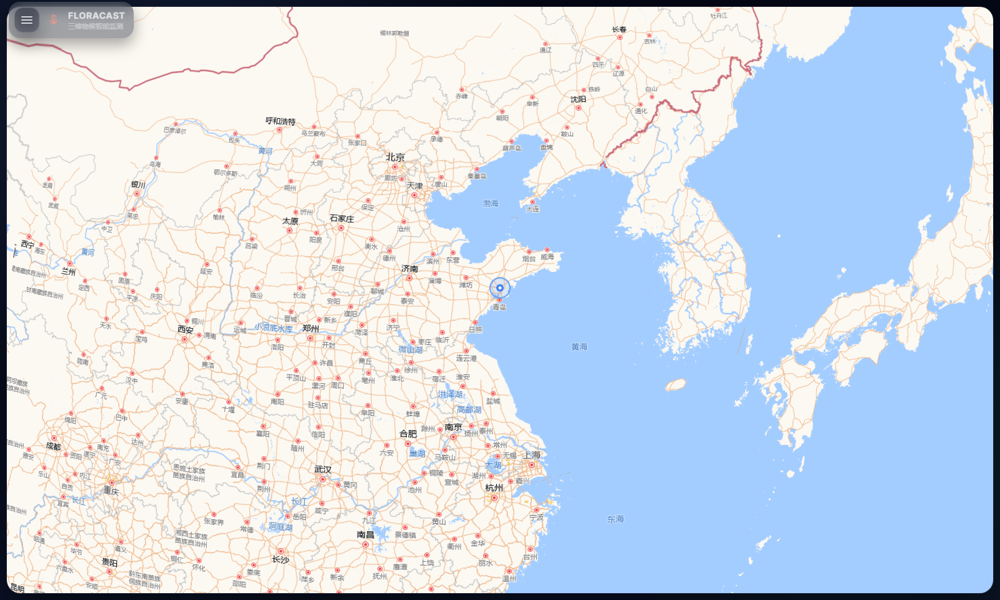  
*Figure 1: 3D Digital Twin Earth overview (Qingdao coastal study area with dynamic illumination, latitude-longitude grid, and high-precision vector basemap).*

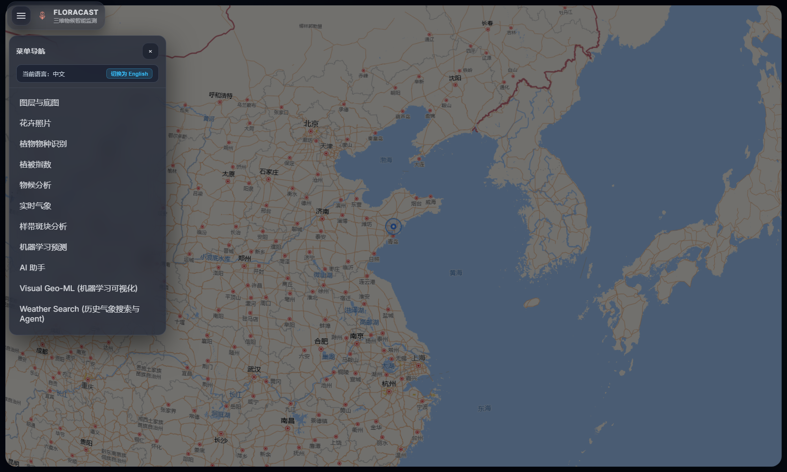  
*Figure 2: System navigation drawer providing access to Research Agent, Natural Language Weather Search, Spatial ML, and Remote Sensing Layer managers.*

---

### 3.2 Collaborative Research Agent Console

Researchers can propose open-ended hypotheses in plain language (e.g., investigating the delayed greenness response of coastal vegetation following severe drought). The agent parses spatial-temporal parameters and executes the coordinated analysis pipeline.

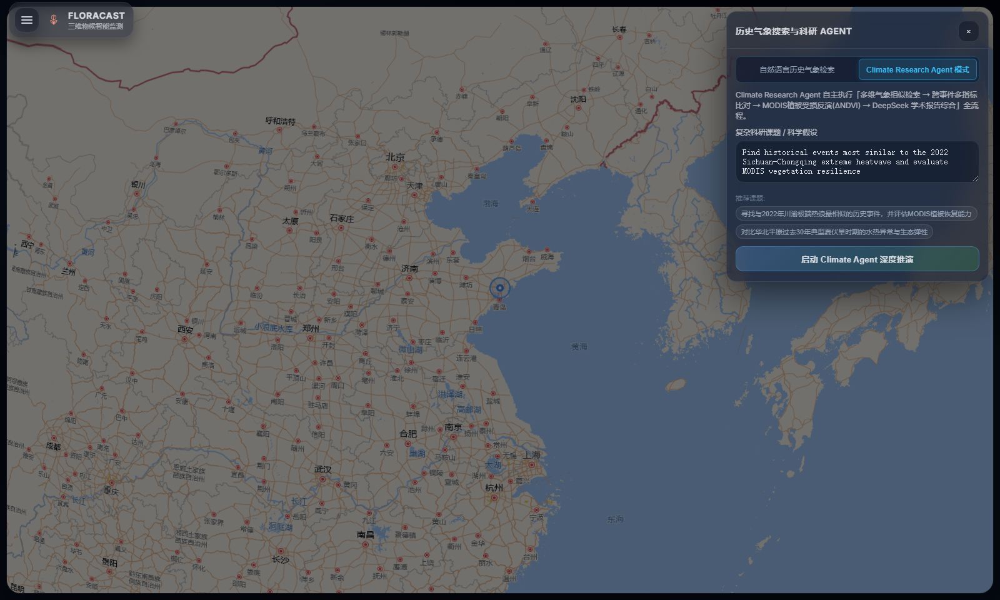  
*Figure 3: Interactive Research Agent console supporting custom scientific queries, center coordinates, radius, and historical baseline configurations.*

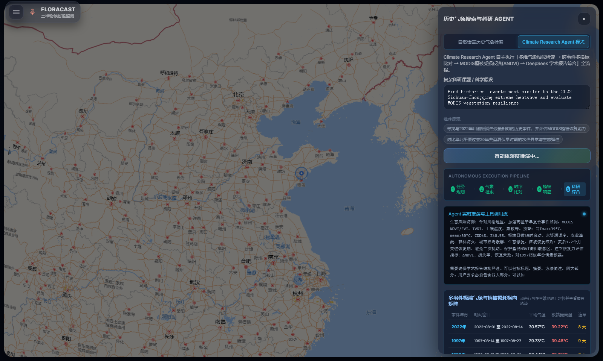  
*Figure 4: Eight-stage pipeline execution with synchronized streaming of the deep reasoning chain.*

---

### 3.3 Meteorological Semantic Search & Multi-Decadal Extreme Event Mining

Natural language weather search automatically translates descriptive statements into structured time-series queries across 40 years of daily meteorological data, discovering candidate heatwaves and drought periods.

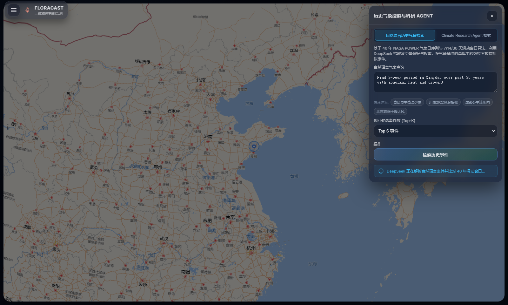  
*Figure 5: Meteorological semantic query panel highlighting candidate extreme weather windows and key multi-variable meteorological indicators.*

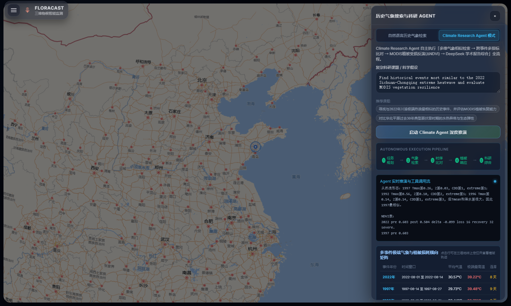  
*Figure 6: Quantitative comparison matrix benchmarking temperature Z-scores, precipitation anomalies, and consecutive dry days across candidate years.*

---

### 3.4 Deterministic Biophysical Modeling & Phenological Inversion

Using MODIS 250m surface reflectance (MOD09Q1) and NDVI/EVI timeseries, the system calculates vegetation green-up, peak growth, and senescence, evaluating drop magnitudes and recovery lag times under climate stress.

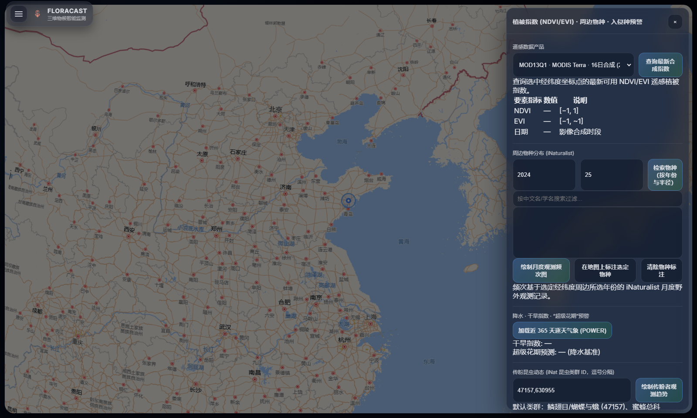  
*Figure 7: MODIS vegetation index inversion and ecological response curves illustrating greenness fluctuations and hydro-thermal drivers.*

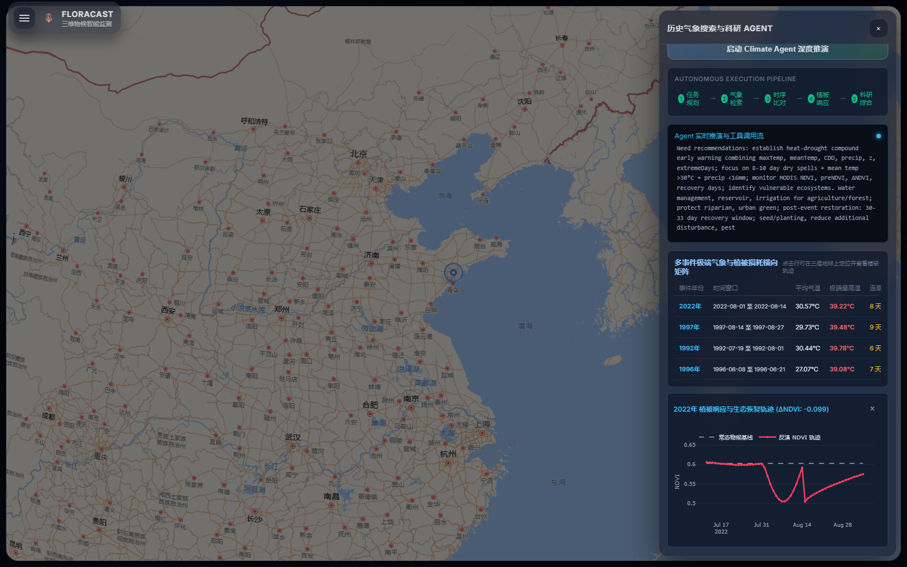  
*Figure 8: Ecological resilience recovery trajectory and executive summary demonstrating stress response and post-disturbance recovery latency.*

---

### 3.5 Client-Side Spatial Machine Learning (Visual Geo-ML)

The in-browser spatial machine learning module provides spatial feature exploration, clustering and map-based visualization. Execution depends on the selected method and browser capabilities.

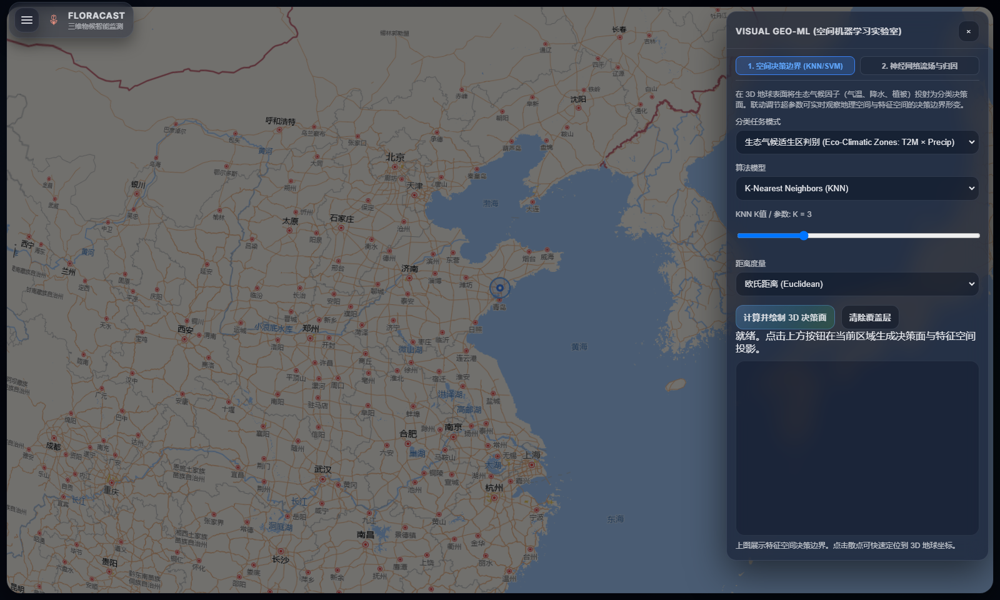  
*Figure 9: Visual Geo-ML interface presenting spatial clustering, feature correlation scatter plots, and neighborhood distribution metrics.*

---

### 3.6 Independent Research Protocol Workbench & Academic Synthesis

Designed for peer-reviewed research and cross-team reproduction, this standalone workbench freezes protocol parameters, verifies bibliographic citations, audits raw data streams, and exports publication-ready academic reports.

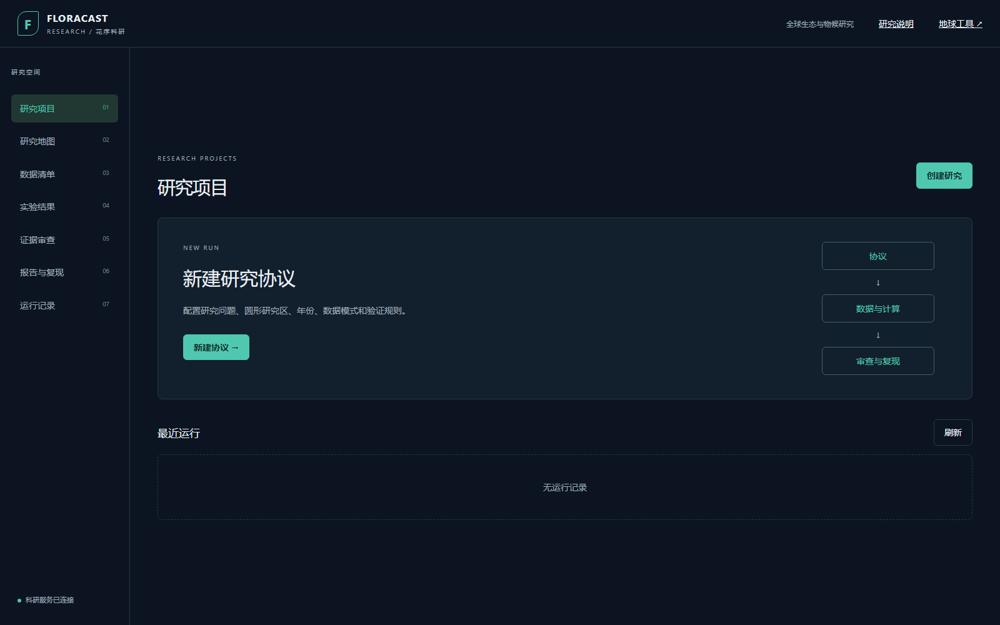  
*Figure 10: Protocol definition interface showing metadata freezing, citation references, and source-data auditing.*

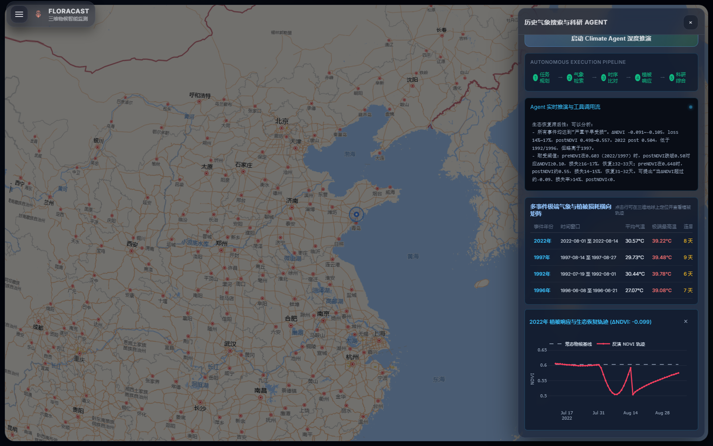  
*Figure 11: Structured academic research report including background, methodology, empirical comparisons, evidence reviews, and scientific limitations.*

---

## 4. Production Security Hardening Architecture

The existing deployment design uses a gateway and a Node.js service. The Nginx settings below describe a deployment configuration; local startup runs the Node.js service directly. Deployment operators configure and verify their own HTTPS and request limits.

```
Client Request (Browser)
       │
       ▼ [Nginx Gateway Layer]
       ├── Referer Verification (Restricts access exclusively to authorized domains)
       ├── Rate Limiting (limit_req: 2 requests/sec, burst cap: 5)
       └── Strict CORS Policies
       │
       ▼ [Node.js Application Layer]
       ├── Secondary Domain Whitelist Enforcement
       ├── Zero Hardcoded Fallbacks (Loads strictly from secure environment variables)
       └── Automated Request Timeouts & Circuit Breakers
       │
       ▼ [AI & Biophysical Compute Backends]
       └── Official DeepSeek API / Local Biophysical Inversion Engines
```

- **Rate Limiting**: Configured with `limit_req_zone $binary_remote_addr zone=floracast_limit:10m rate=2r/s;` to block automated scraping and excessive calls.
- **Anti-Hotlinking (Referer Inspection)**: Enforces `valid_referers server_names *.openl.work;` to reject requests lacking proper origin headers.
- **Strict CORS**: Eliminates wildcard CORS permissions, ensuring queries originate only from designated domains.
- **Credential Hygiene**: Source code contains zero hardcoded API keys; all production secrets are injected through managed environment variables.

---

## 5. Technology Stack & System Components

| Layer | Technologies & Dependencies | Purpose & Responsibilities |
| :--- | :--- | :--- |
| **Presentation Layer** | CesiumJS (1.136.0) | High-performance 3D digital twin Earth interaction and satellite rendering |
| | Plotly.js (2.35.2) | Interactive scientific scatter plots, radar charts, and recovery curves |
| | TensorFlow.js | Client-side spatial clustering and linear trend regressions |
| | Marked.js | Markdown report rendering with KaTeX mathematical formulas |
| **Service Layer** | Node.js (v20+) & Express | API gateway, Server-Sent Events (SSE) streaming, and caching |
| | Axios & Multer | Data fetching pipelines and satellite tile streaming proxies |
| | openJiuwen Protocol Layer | Eight-stage research workflow orchestration and state management |
| **Scientific Models** | DeepSeek Official API (V3/R1) | Natural language intent parsing and synthesis of academic research reports |
| | Qwen-VL Vision API | Plant organ classification and species confidence identification |
| | Biophysical Inversion Engine | Thermal thresholds (GDD) and surface energy balance equations |
| **Gateway & Ops** | Nginx (1.24+) | SSL termination, rate limiting, and reverse proxy routing |
| | Systemd / Docker | Process daemon management and automated container recovery |

---

## 6. Quick Start & Local Deployment

### Prerequisites
- Node.js 20.0 or higher (Node.js 22 LTS recommended)
- Git
- Modern browser supporting WebGL 2.0 (Google Chrome, Microsoft Edge, or Firefox)

### Installation

```bash
# Clone the repository
git clone https://github.com/Karl-XZ/FloraCast-Research.git
cd FloraCast-Research

# Install server dependencies
cd server
npm ci
```

### Environment Setup

Create a `.env` file in the project root directory:

```ini
# DeepSeek API Configuration (Meteorological parsing and academic synthesis)
DEEPSEEK_API_KEY=your_deepseek_api_key
DEEPSEEK_API_BASE=https://api.deepseek.com
DEEPSEEK_MODEL=deepseek-chat

# Optional: Qwen-VL API (Plant multi-modal visual recognition)
QWEN_API_KEY=your_qwen_api_key
QWEN_API_BASE=https://dashscope.aliyuncs.com/compatible-mode/v1
QWEN_TEXT_MODEL=qwen-plus
QWEN_VISION_MODEL=qwen-vl-plus

# Server Port
PORT=5174
```

### Run Application

```bash
# From within the server directory
npm start
```

Access in your browser:
- 3D Digital Twin Earth: `http://localhost:5174/`
- Independent Research Workbench: `http://localhost:5174/research.html`

From the repository root, run `npm test --prefix server` and `npm run verify:local --prefix server`. See [deployment](docs/deployment.md) for configuration dependencies and [verification](docs/verification.md) for the checks covered.

---

## 7. Environment Configuration Guidelines

1. **Zero Credential Hardcoding**: Server-side modules strictly read from `process.env.*` and raise explicit exceptions when keys are missing.
2. **Git Repository Hygiene**: All `.env` files and local caches are protected by `.gitignore` to prevent accidental commits.
3. **Usage Monitoring**: Configure daily quota ceilings and balance alerts in your AI provider dashboard to avoid unexpected usage spikes.

---

## 8. Data Sources & Open Licenses

- **Satellite Remote Sensing**: NASA GIBS, MODIS Terra/Aqua surface reflectance observations.
- **Meteorological Reanalysis**: NASA POWER Global Agroclimatology Daily Dataset (1985–2024).
- **Marine & Atmospheric Forecast Tiles**: [OpenPortGuide](https://weather.openportguide.de/) (Licensed under [CC BY-NC-SA 4.0](https://creativecommons.org/licenses/by-nc-sa/4.0/)).
- **Basemap Layers**: Gaode Vector Maps, Baidu Satellite Imagery.
- **Open Source License**: FloraCast code is released under the [MIT License](LICENSE).

Full software, map, data, photo and model-service notices are maintained in [THIRD_PARTY_NOTICES.md](THIRD_PARTY_NOTICES.md). Exact server dependency versions are recorded in the lockfile and [dependency inventory](docs/dependency-inventory.md).
